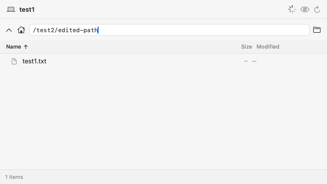
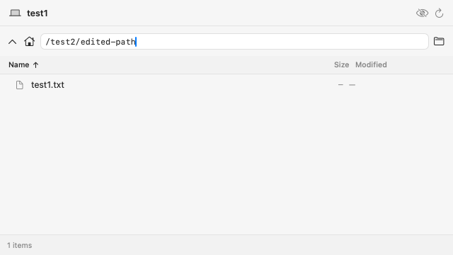

# Synthetic Files path-draft demo

This demo branch combines the independent font-family, terminal-theme repaint and Files path-draft fixes. Production PR branches do not contain its workflow or capture helper.

The GitHub Actions test host renders a real Files pane with only synthetic `test1`, `/test1` and `/test2/edited-path` data. AppKit cached images capture the test-owned view, never a desktop or a real agent/session.

Verified screenshots:

- `path-edit-before-reply.png` and `path-edit-after-reply.png`: an edited, unsubmitted path remains visible after the delayed directory response.

The first CI attempt could not use the window compositor because the runner denied screen-capture permission. Files uses the previously validated AppKit caching method instead. That method is not a reliable capture of Metal terminal frames, so font/theme screenshots remain pending; no substituted renderings are presented as terminal screenshots.

The Files fixture and screenshot export passed on [GitHub Actions run 40886058440](https://github.com/bw-rsp/herdrm/actions/runs/40886058440). Both images were inspected: the path remains `/test2/edited-path`, the synthetic `test1.txt` listing stays present, and the loading indicator disappears after the reply.

Before the delayed reply:

After the delayed reply:

The demo job runs only the screenshot-producing Files case. Complete test suites passed separately on the three production branches; this focused run is not a replacement for those results.
